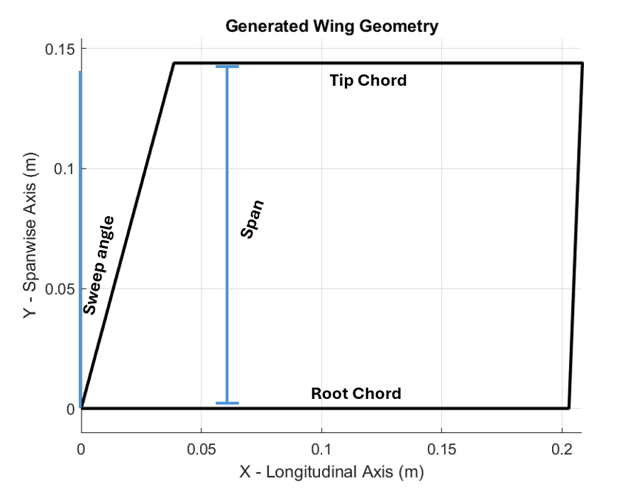

# Rocket Dynamics for GNCSIM 2.0

### State Vector Definition

The state vector is all the necessary information to describe the state of the system. For GNCSIM 2.0, the state vector includes mass, position in the inertial frame, velocity in the inertial frame, quaternion from inertial to body, and angular rate expressed in the body frame.

$$
\mathbf{x} = 
\begin{bmatrix}
    m \\
    p_I \\
    v_B \\
    q_{IB} \\
    \omega_B
\end{bmatrix}
$$

where:
* $m$ is the mass of the body.
* $p_I = [x, y, z]^T$ is the position vector in the inertial frame.
* $v_B = [v_x, v_y, v_z]^T$ is the velocity vector in the body frame.
* $q_{IB} = [q_0, q_1, q_2, q_3]^T$ is the quaternion representing the orientation from the inertial frame to the body frame.
* $\omega = [\omega_x, \omega_y, \omega_z]^T$ is the angular velocity vector in the body frame.

The total number of states in the system is 14, which includes 1 for mass, 3 for position, velocity and angular rate and 4 for quaternion.

### Equations of Motion

Almost all dynamical systems can be written in the form of $\dot{\mathbf{x}}=f(\mathbf{x},\mathbf{u},t)$ and rockets are no exception. This formula is saying that the derivative of the state vector $\dot{\mathbf{x}}$ is a function of the current state $\mathbf{x}$, our control $\mathbf{u}$ and time $t$.

The time derivative of the state vector, $\dot{\mathbf{x}}$, is given by the following equations:


$$
% Mass
\begin{equation}
\dot{m} = f(t)
\end{equation}
$$

$$
% Position
\begin{equation}
\dot{p}_I = \mathbf{C}_{BI} v_B
\end{equation}
$$

$$
% Velocity
\begin{equation}
\dot{v}_B = \frac{F_b}{m} + \mathbf{C}_{IB}(q) g
\end{equation}
$$

$$
% Quaternion
\begin{equation}
\dot{q} = \frac{1}{2} \boldsymbol{\Omega}(\omega) q
\end{equation}
$$

$$
% Angular Velocity
\begin{equation}
\dot{\omega} = \mathbf{I}_b^{-1} \left(M_b - \omega \times (\mathbf{I}_b \omega) \right)
\end{equation}
$$

where:
* $f(t)$ is the motor burn rate as function of time.
* $F_b$ is the sum of external forces in the body frame.
* $M_b$ is the sum of external moments (torques) in the body frame.
* $g = [0, 0, -9.81]^T$ is the gravitational acceleration vector in the inertial frame.
* $\mathbf{C}_{IB}$ is the direction cosine matrix that transforms vectors from the inertial frame to the body frame (it is the transpose of $\mathbf{C}_{BI}$). $\mathbf{C}_{BI}=\mathbf{C}_{IB}^T$

$$
\begin{equation}
C_{IB}(q) =
\begin{bmatrix}
1 - 2(q_2^2 + q_3^2) & 2(q_1 q_2 + q_0 q_3) & 2(q_1 q_3 - q_0 q_2) \\
2(q_1 q_2 - q_0 q_3) & 1 - 2(q_1^2 + q_3^2) & 2(q_2 q_3 + q_0 q_1) \\
2(q_1 q_3 + q_0 q_2) & 2(q_2 q_3 - q_0 q_1) & 1 - 2(q_1^2 + q_2^2)
\end{bmatrix}
\end{equation}
$$

* $\mathbf{I}_b$ is the moment of inertia tensor in the body frame. Note that if the moment of inertia is dependent on the mass and CG location.
* $\boldsymbol{\Omega}(w)$ is the skew-symmetric matrix representation of the angular velocity $\omega$.
$$
\begin{equation}
\boldsymbol{\Omega}(q) = \begin{bmatrix} 0 & -\omega_x & -\omega_y & -\omega_z \\ \omega_x & 0 & \omega_z & -\omega_y \\ \omega_y & -\omega_z & 0 & \omega_x \\ \omega_z & \omega_y & -\omega_x & 0 \end{bmatrix} 
\end{equation}
$$

### Coordinate Frames

There are three major frames used in calculating forces and moments. The first is the **inertial frame**, which (as the name implies) is inertial, with the x-axis facing east, the y-axis facing north, and the z-axis facing up. This frame is also known as **ENU (East, North, Up)**.

The next frame is the **body frame**, with the origin at the nose tip and the x-axis facing toward the tail. The y and z axes are defined arbitrarily.

Finally, the **component frame** is defined the same as the body frame; however, the origin is located at the tip of each component.

Vectors can be computed between the frames using rotation matrix. For example $\mathbf{C}_{BI}$ is the rotation matrix from body to inertial defined above. The rotation matrix from body to component will be defined in a different section. 


### Aerodynamics

These equations can simulate any rigid body with changing mass, however in order to simulate the rigid body dynamics of a rocket, aerodynamics must be taken into account. To do this the forces and moments must be a function of the state. The forces and moments are a function of the altitude $h$, inertial velocity $v_B$, orientation $q$ and angular rate $\omega$. 

$$
\begin{equation}
F_b=f(h, v_B, q, \omega)
\end{equation}
$$

$$
\begin{equation}
M_b=f(h, v_B, q, \omega)
\end{equation}
$$

The first step in computing the forces and moments is getting the velocity in the body frame. To do this a cosine direction matrix is be used defined in a previous section.

$$
\begin{equation}
v_B=\boldsymbol{C}_{IB}(q)v_w + v_B
\end{equation}
$$

This formula rotates the velocity in the inertial to the velocity in the body frame. $v_w$ is the velocity of the wind in the inertial frame which can be assumed to be zero if the winds are calm.

Next the velocity must be converted to every componet frame. For the body this rotation matrix is the identity matrix, however for the fin the rotation matrix is defined below where $\delta$ represents the control deflection around the body y axis and $\theta$ represents the rotation angle around the body x axis.

$$
\begin{equation}
\boldsymbol{C}_{BC} = R_y(\delta)R_x(\theta)
\end{equation}
$$

$$
\begin{equation}
\boldsymbol{C}_{BC}(\delta, \theta) = 
\begin{bmatrix}
\cos\delta & 0 & -\sin\delta \\
0 & 1 & 0 \\
\sin\delta & 0 & \cos\delta
\end{bmatrix}
\begin{bmatrix}
1 & 0 & 0 \\
0 & \cos\theta & \sin\theta \\
0 & -\sin\theta & \cos\theta
\end{bmatrix}
\end{equation}
$$

Assuming there are four fins each with zero control deflection $\delta$, the rotation matrix for each fin would be when $\delta=0^\circ$ and $\theta=0^\circ$, $\theta=90^\circ$, $\theta=180^\circ$, and $\theta=270^\circ$. It is important to note that the rotation around the x-axis $\theta$ remains static as it represents the placement of the fins, whereas the control deflection $\delta$ may be dynamic as it represents control deflection of the fin.

From this, the component velocity and angular rate can be found using the formula below.

$$
\begin{equation}
v_C = \boldsymbol{C}_{BC}(\delta, \theta)(v_B + \omega \times r_{BC})
\end{equation}
$$

$$
\begin{equation}
w_C = \boldsymbol{C}_{BC}(\delta, \theta)w_B
\end{equation}
$$

$r_{BC}$ represents the translation vector from the center of mass to the component reference location. $v_C$ and $\omega_C$ represent the velocity and angular rate of the fin.

Now that the components velocity is known the aerodynamic forces and moments can be calculated. To do this the angle of attack $\alpha$, mach number $M$ and altitude $h$ (in meters) must be known. The formulas for them can be found below with $u$, $v$, and $w$ representing the x, y and z components of velocity and $a$ is the speed of sound, assumed to be 343 m/s.

$$
\begin{equation}
\alpha=\text{atan2}(w,u)
\end{equation}
$$

$$
\begin{equation}
M=\frac{\sqrt{u^2+v^2+w^2}}{a}
\end{equation}
$$

Once $\alpha$, $M$ and $h$ are known this can be used to calculate lift drag and pitching moment. To do this DATCOM is used get the coefficient data from current state of $\alpha$, $M$ and $h$. Getting this lookup table is converted in another section however a 3D linear lookup table is used to get the aerodynamic coefficient.

$$
\begin{equation}
[c_n, c_a, c_m] = \text{aero}(\alpha, M, h)
\end{equation}
$$

The normal coefficient $c_n$, axial coefficient $c_a$ and pitching moment coefficient $c_m$ can be converted to forces and moments in the body frame using the formula below where $S$ is surface area, $c$ is chord length and $q_{\infin}$ is dynamic pressure.

$$
\begin{equation}
N=c_n q_{\infin}S
\end{equation}
$$

$$
\begin{equation}
A=c_a q_{\infin}S
\end{equation}
$$

$$
\begin{equation}
M=c_m q_{\infin}c
\end{equation}
$$

$$
\begin{equation}
q_{\infin} = \frac{1}{2}\rho(h) v^2
\end{equation}
$$

DATCOM does not give lateral forces or roll/yaw moments so it is assumed that they are equal to zero. Therefore the final forces and moments in the component frame are defined below.

$$
\begin{equation}
F_c = [N, 0, A]
\end{equation}
$$

$$
\begin{equation}
M_c = [0, M, 0]
\end{equation}
$$

To convert the forces and moments in the component frame to the body frame a conversion must take place. Recall that $\boldsymbol{C}_{BC} = R_y(\delta)R_x(\theta)$. The inverse can be calculated by taking the transpose.

$$
\begin{equation}
\boldsymbol{C}_{CB} = \boldsymbol{C}_{BC}^T
\end{equation}
$$

From this the forces and moments can be computed using the following formula where $r_{BC} is the distance from the CG to the components reference.

$$
\begin{equation}
F_b = \boldsymbol{C}_{CB}(\delta, \theta)F_c
\end{equation}
$$

$$
\begin{equation}
M_b = \boldsymbol{C}_{CB}(\delta, \theta)M_c + r_{BC} \times F_b
\end{equation}
$$

Once the forces and moments are determined, the process outlined in this section is repeated for all fins and the body. The resulting forces and moments are then summed to obtain the total values, which are then used in the dynamics defined by Equations (1)–(5).


### DATCOM Buildup for Fin

The fins can be defined using five parameters as shown in the MATLAB code below.

```
    fin_params.numFins = 4;        % [~]
    fin_params.rootChord = 0.203;  % [m]
    fin_params.tipChord = 0.17;    % [m]
    fin_params.finSpan = 0.144;    % [m]
    fin_params.sweepDeg = 15.0;    % [deg]
```

* *numFins* is the number of fins attached to the body.
* *rootChord* is the length of the fin’s base (where it attaches to the body).
* *tipChord* is the length of the fin’s outer edge (furthest from the body).
* *finSpan* is the distance from the body surface to the fin tip.
* *sweepDeg* is the angle of the fin’s leading edge relative to the body axis.

From that the full geometry of the fin can be defined as shown below.



The parameters above can be formatted into a DATCOM input file as shown below. This file defines the geometry, flow conditions, and analysis setup for a wing-only aerodynamic analysis.

```
 $FLTCON NMACH=3.0, MACH(1)=0.2000,
 0.4000,
 0.6000,
 NALT=3.0, ALT(1)=0.0000,
 5000.0000,
 10000.0000,
 NALPHA=11.0, ALSCHD(1)=-10.0000,
 -8.0000,
 -6.0000,
 -4.0000,
 -2.0000,
 0.0000,
 2.0000,
 4.0000,
 6.0000,
 8.0000,
 10.0000,
 LOOP=2.0$
 $OPTINS SREF=0.0269, CBARR=0.1870, BLREF=0.1440$
 $SYNTHS XW=0.0000, XCG=0.0655$
 $WGPLNF CHRDR=0.2030, CHRDTP=0.1700, SSPN=0.1440, SSPNE=0.1440,
 SAVSI=15.0000, DHDADI=0.0000, TYPE=1.0$
NACA W 4 0012
CASEID GENERATED WING-ONLY ANALYSIS
NEXT CASE
```

#### Flight Conditions

The flight conditions defines the condition grid, also known as the combinations of Mach number, altitude, and angle of attack that DATCOM will compute aerodynamic coefficients for.

```
 $FLTCON NMACH=3.0, MACH(1)=0.2000,
 0.4000,
 0.6000,
 NALT=3.0, ALT(1)=0.0000,
 5000.0000,
 10000.0000,
 NALPHA=11.0, ALSCHD(1)=-10.0000,
 -8.0000,
 -6.0000,
 -4.0000,
 -2.0000,
 0.0000,
 2.0000,
 4.0000,
 6.0000,
 8.0000,
 10.0000,
 LOOP=2.0$
```
* *NMACH=3.0*: There are 3 mach numbers (in this case 0.2, 0.4 and 0.6).
* *NALT=3.0*: There are 3 altitudes (in this case 0, 5km and 10km).
* *NALPHA=11.0*: There are 11 angle of attack in degrees.
* *LOOP=2.0*: DATCOM will loop over Mach and altitude combinations (a grid sweep)
 
It is important to note that the conditions can be chosen from MATLAB and are not hard coded.

#### Reference Dimensions
These are used to nondimensionalize aerodynamic coefficients.

```
 $OPTINS SREF=0.0269, CBARR=0.1870, BLREF=0.1440$
```
* *SREF*: Reference area in $m^2$.
* *CBARR*: Mean aerodynamic chord in $m$.
* *BLREF*: Reference span in $m$.

#### Longitudinal Geometry (CG, Wing Position)
These parameters are used to compute pitching moment and stability derivatives.

```
 $SYNTHS XW=0.0000, XCG=0.0655$
```
* *XW*: Wing apex position from nose in $m$.
* *XCG*: Center of gravity location from nose in $m$.

#### Wing Geometry Definition

These are used to define the platform geometry of the wing.

```
 $WGPLNF CHRDR=0.2030, CHRDTP=0.1700, SSPN=0.1440, SSPNE=0.1440,
 SAVSI=15.0000, DHDADI=0.0000, TYPE=1.0$
```
* *CHRDR*: Root chord in $m$
* *CHRDTP*: Tip chord in $m$
* *SSPN*: Semispan to the break or tip in $m$ (SSPN is assumed to be equal to SSPNE)
* *SSPNE*: Total semispan in $m$
* *SAVSI*: Leading edge sweep angle in degrees
* *DHDADI*: Dihedral angle in degrees (always hard coded to zero)
* *TYPE*: Wing type (1.0 = full-span wing)

#### Airfoil and Other

Defines a NACA 0012 symmetric airfoil and adds labels.

```
NACA W 4 0012
CASEID GENERATED WING-ONLY ANALYSIS
NEXT CASE
```
* *NACA W 0012*: Defines a NACA 0012 symmetric airfoil for wing.
* *CASEID*: A label for the analysis
* *NEXT CASE*: Tells DATCOM that this case is complete and the next one follows

### DATCOM Buildup for Body

The body can be defined using five parameters as shown in the MATLAB code below.

```
    bodyParams.noseLength = 0.61;  % [m]
    bodyParams.bodyLength = 2.03;  % This does not include nose code [m]
    bodyParams.rocketDiameter = 0.157;  % [m]
```

* *noseLength* is the total length of the nose 
* *bodyLength* is the length of the body exluding nosecone
* *rocketDiameter* is the diamaeter of rocket

Note that the flight conditions reference dimensions are assumed to be the same as the fin.

```
 $FLTCON NMACH=3.0, MACH(1)=0.2000,
 0.4000,
 0.6000,
 NALT=3.0, ALT(1)=0.0000,
 5000.0000,
 10000.0000,
 NALPHA=11.0, ALSCHD(1)=-10.0000,
 -8.0000,
 -6.0000,
 -4.0000,
 -2.0000,
 0.0000,
 2.0000,
 4.0000,
 6.0000,
 8.0000,
 10.0000,
 LOOP=2.0$
 $OPTINS SREF=0.0194, CBARR=2.6400, BLREF=0.1570$
 $SYNTHS XW=0.0000, XCG=0.6000$
 $BODY   NX=14.0,
 X(1)=0.0000, 0.0678, 0.1356, 0.2033, 0.2711, 0.3389, 0.4067, 0.4744, 0.5422,
 0.6100, 1.1175, 1.6250, 2.1325, 2.6400,
 R(1)=0.0001, 0.0168, 0.0314, 0.0440, 0.0546, 0.0633, 0.0700, 0.0748, 0.0776,
 0.0785, 0.0785, 0.0785, 0.0785, 0.0785$
DIM M
NEXT CASE
```

#### Longitudinal Geometry (CG, Body Position)
These parameters are used to compute pitching moment and stability derivatives.

```
 $SYNTHS XW=0.0000, XCG=0.0655$
```
* *XW*: Body apex position from nose tip in $m$
* *XCG*: Center of gravity location from nose tip in $m$

#### Body Geometry Definition

```
 $BODY   NX=14.0,
 X(1)=0.0000, 0.0678, 0.1356, 0.2033, 0.2711, 0.3389, 0.4067, 0.4744, 0.5422,
 0.6100, 1.1175, 1.6250, 2.1325, 2.6400,
 R(1)=0.0001, 0.0168, 0.0314, 0.0440, 0.0546, 0.0633, 0.0700, 0.0748, 0.0776,
 0.0785, 0.0785, 0.0785, 0.0785, 0.0785$
 ```
 * *BODY*: Body x positions in $m$
 * *R*: Body radius positions at corresponding body position $m$ 

### Pitch Control

In order to develop a pitch controller a linear time-invariant (LTI) system must be developed. This can be challenging as our dynamics are non-linear and time-varying, however trim points can be used to linearize the dynamics around a point from which the system can be linear and time-invariant. Once a point is found a reduced order model can be developed to transform our 14 dimensional model into a 3 dimensional LTI system for pitch.

#### Finding trim points

Any trim point must satisfy the form $\dot{x}^{*}=f(x^{*},u^{*})$ where $x^{*}$ is the state, $\dot{x}^{*}$ is the state derivative, $u^{*}$ is the control and $f$ is the dynamics. Most of the time we want $\dot{x}^{*}$ to be zero for some of the states. This is because if $\dot{x}^{*}$ is assumed to be zero then that is a steady condition where the system can maintain a constant motion and a LTI system can be developed around that point.

#### Trim point optimization

The key idea of trim points is that we have some states that are fixed and some states are free. For example when developing a pitch controller at 5 degrees pitch attitude the orientation (quaternion) and angular rate are fixed. The free variable would be the moment or fin deflection needed to maintain steady state flight and the angle of attack. In this case that would mean minimizing angular rate and angular  acceleration. Below is a more mathematical explanation of what is going on.

<u>**State (x)**</u>
* $p_I=[0,0,0]^T$ 
* $v_B=[v \text{cos}(\alpha), 0, v \text{sin}(\alpha)]^T$
* $q=$ eurl2quat($[0,\theta,0]^T$)
* $\omega=[0,0,0]^T$

<u>**Control (u)**</u>
* $u=[M_x, M_y, M_z]$

<u>**Free Variables (z)**</u>
* $z=[M_x, M_y, M_z, \alpha]$

<u>**Fixed Variables**</u>
* $\theta=5^\circ$
* $v=100 \frac{m}{s}$

Both the state vector $x$ and control $u$ are a function of the free variables $z$. Because of this the derivative of the state vector can be a function of $z$ as shown below.

$$
\begin{equation}
\dot{x}(z)=f(\bar{x}(z), \bar{u}(z))
\end{equation}
$$

Because the goal is to develop a attitude controller the derivate of the state vector relating to attitude should be zero (i.e. $\dot{q}=0$, $\dot{\omega}=0$). So a optimization is preformed to find for what free variables $z$ does $\dot{q}=0$ and $\dot{\omega}=0$. Let the objective of this optimization be defined below.

$$
\begin{equation}
J= \sum_{i \in I} (\dot{x}^*_i(z))^2=\sum_{i \in I} f_i(\bar{x}(z), \bar{u}(z))^2
\end{equation}
$$

The index $i$ is the $i^{th}$ element of the state vector. In the case for a pitch controller the $I=[8,9,10,11,12,13,14]$ because these are the indices that correspond the quaternion ($q$) and angular rate ($\omega$). The intuition behind this optimization can be summed up in the question: **What values of $z$ (moment and angle of attack) will return the lowest value of angular rate ($\dot{q}$) and angular acceleration ($\dot{\omega}$) at the current state (100 $\frac{m}{s}$ and at 5$^\circ$ pitch)?**


$$
\begin{equation}
z^*=\argmin_z(J) 
\end{equation}
$$

Once the free variables are found they can then be converted to state as shown below.

$$
\begin{equation}
x^*=\bar{x}(z^*), \qquad u^*=\bar{u}(z^*), \qquad \dot{x}^*=f(x^*,u^*)
\end{equation}
$$

#### Reduced Order Model

Once a trim point is found the dynamics can be linearized around that point by calculating the Jacobian of the dynamics with respect to the state and control and the trim point. The Jacobian can be calculated symbolically or using finite difference.

$$
\begin{equation}
A=\frac{\partial f}{\partial x}\Big\vert_{x=x^*} \qquad B=\frac{\partial f}{\partial u}\Big\vert_{u=u^*}
\end{equation}
$$

From the linearization a LTI system can be derived as the following where $\delta x = x - x^*$ and $\delta u = u - u^*$ 

$$
\begin{equation}
\delta \dot{x} = A \delta x+ B \delta u
\end{equation}
$$

Recall that the primary goal of this section is to find a pitch controller however the dynamics for pitch are nonlinear but under certain assumptions the dynamics can be linear. The major variables that effect pitch are pitch $\theta$, pitch rate $q$ and angle of attack $\alpha$. Below are the steps to reduce the 14 dimensional state vector into the 3 dimensional state vector $x_3 = [\theta, q, \alpha]^T$.

Going forward the stat vector of the full 6 degree of freedom dynamics with 14 states will be called $x_{14}$ and the new reduced state vector with 3 states will be $x_3$.

The first step is to make a function that takes the full 14 state vector $x_{14}$ and reduces it to the smaller $x_3$ state vector.

$$
\begin{equation}
x_3=g(x_{14})
\end{equation}
$$

[TODO: Define $g$]

Because the function $g$ is nonlinear the Jacobian is taken to linearize it around the trim point. 

$$
\begin{equation}
J_g=\frac{\partial g}{\partial x_{14}}\Big\vert_{x_{14}=x^*_{14}} \in \real^{3 \times 14}
\end{equation} 
$$

Using the Jacobian above $A=A_{14}$ and $B=B_{14}$ a new linear system can be formulated where the input state vector is full and the state derivative is in the reduced states.

$$
\begin{equation}
\delta \dot{x}_{3} = J_g (A_{14} \delta x_{14} + B_{14} \delta u)
\end{equation}
$$

Furthermore the function $h$ is defined to expand the lower dimensional state vector $x_3$ to the full state vector $x_{14}$.

$$
\begin{equation}
x_{14}=h(x_3)
\end{equation}
$$

[TODO: Define $h$]

To make a LTI system of the reduced form the Jacobian around the trim point at the reduced state $x^*_3$ ($x^*_3=g(x^*_{14})$) is taken.

$$
\begin{equation}
J_h=\frac{\partial h}{\partial x_{3}}\Big\vert_{x_{3}=x^*_{3}} \in \real^{14 \times 3}
\end{equation} 
$$

From this a linear transformation can be used to lift the reduced state to the higher order sate.

$$
\begin{equation}
\delta x_{14} = J_h \delta x_3
\end{equation}
$$

Now a LTI system can formulated using only the reduced state vector as shown below.

$$
\begin{equation}
\delta \dot{x}_{3} = J_g A_{14} J_h \delta x_3 + J_g B_{14} \delta u
\end{equation}
$$

From this $A_3 =J_g A_{14} J_h$ and $B_3 = J_g B_{14}$ and the simple linear system is shown below. 

$$
\begin{equation}
\delta \dot{x}_{3} = A_3 \delta x_3 + B_3 \delta u
\end{equation}
$$

#### Control


### Trim Points


### Class Structure
TODO

### Simulation
TODO

