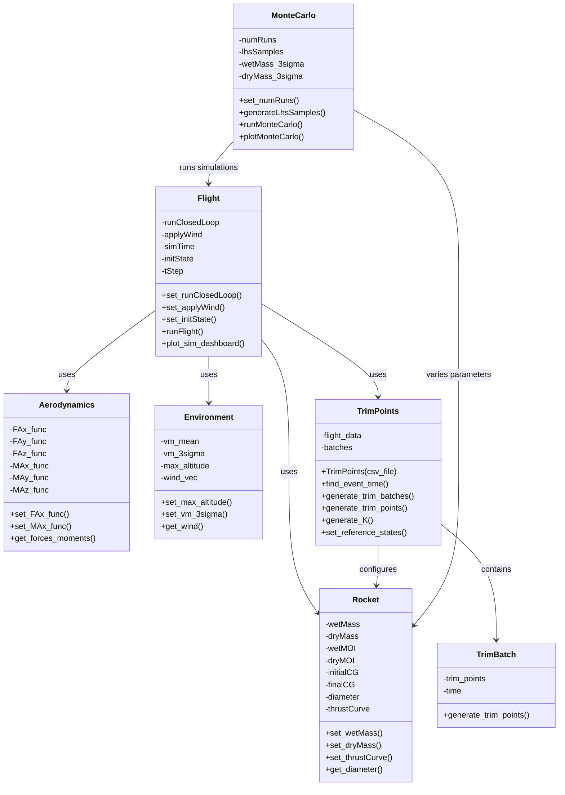

# GNCSIM Class Diagram

This document describes the class structure and relationships in the GNCSIM codebase based on the analysis of `src/` directory and `jetVanes_MasterFile.m`.

## Class Overview

## Class Relationships - jetVanes_MasterFile.m example

### Primary Flow:
1. **Rocket Configuration**: Creates `Rocket` object ("Doof") and configures all physical parameters
2. **Aerodynamics Setup**: Creates `Aerodynamics` object and sets symbolic force/moment functions
3. **Environment Setup**: Creates `Environment` object for atmospheric conditions and wind
4. **Flight Configuration**: Creates `Flight` object with simulation parameters
5. **Trim Points Generation**: Creates `TrimPoints` object from flight profile CSV, generates trim batches and points
6. **Flight Simulation**: Runs controlled flight using all configured objects
7. **Monte Carlo Analysis**: Creates `MonteCarlo` object and runs statistical analysis

### Key Dependencies:
- **Flight.runFlight()** requires: Rocket, Environment, Aerodynamics, TrimPoints
- **TrimPoints.generate_trim_points()** requires: Rocket, Environment, Flight, Aerodynamics  
- **MonteCarlo.runMonteCarlo()** requires: Flight, Rocket, Environment, Aerodynamics, TrimPoints
- **TrimPoints** contains multiple **TrimBatch** objects
- **TrimPoints** reads flight profile data from CSV files

### Inheritance:
- **Rocket** extends `handle` (for reference semantics)
- **Flight** extends `handle`
- **TrimPoints** extends `handle`
- **MonteCarlo** extends `handle`
- **Aerodynamics** extends `handle`
- **Environment** is a regular class (value semantics)

## Supporting Classes:
- **ActuatorModel**: Actuator modeling functionality
- **Navigation**: Navigation algorithms
- **PID**: PID control implementation
- **Sensor Package** (+Sensor folder): Contains Accelerometer, Barometer, GPS, Gyro, Magnetometer classes

## Usage Pattern:
The jetVanes_MasterFile.m follows a clear sequence:
1. Object instantiation and configuration
2. Symbolic computation and function generation
3. Trim point generation and controller design
4. Single flight simulation
5. Monte Carlo statistical analysis
