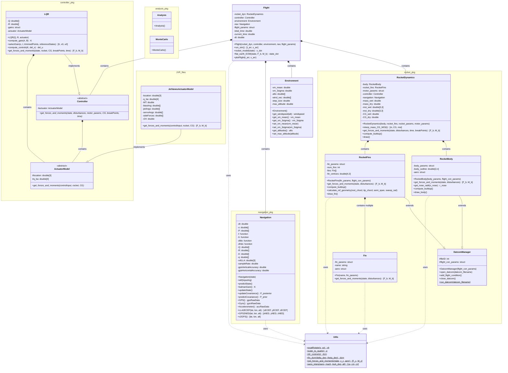

# GNCSIM Class Diagram

This document provides a comprehensive overview of the class architecture in GNCSIM, showing how all classes interact and work together to create a complete rocket simulation system.

## Overview

GNCSIM is organized into several packages that handle different aspects of rocket simulation:

- **rocket_pkg**: Core rocket dynamics and aerodynamics
- **controller_pkg**: Control system implementations
- **navigation_pkg**: Navigation and sensor modeling
- **analysis_pkg**: Analysis and Monte Carlo capabilities
- **JVR_files**: Jet vane actuator implementations

## Class Diagram

## Architecture Description

### Main Simulation Flow

The **Flight** class serves as the main orchestrator for the entire simulation. It coordinates the interaction between:

1. **RocketDynamics** - Manages the physical properties and aerodynamic forces of the rocket
2. **Controller** - Provides control system logic and actuator commands
3. **Environment** - Models atmospheric conditions and wind
4. **Navigation** - Handles state estimation and sensor modeling

### Key Design Patterns

#### 1. Template Method Pattern
The **DatcomManager** class provides a common framework for generating DATCOM input files, running the DATCOM executable, and importing aerodynamic data. Both **RocketBody** and **RocketFins** inherit from this class to leverage shared DATCOM functionality.

#### 2. Strategy Pattern
Abstract classes **Controller** and **ActuatorModel** allow for different implementations:
- **LQR** implements the Controller interface for Linear Quadratic Regulator control
- **JetVanesActuatorModel** implements the ActuatorModel interface for jet vane actuation

#### 3. Composition over Inheritance
The **Flight** class uses composition rather than inheritance to integrate major subsystems, providing flexibility in swapping implementations.

#### 4. Static Utility Pattern
The **Utils** class provides common mathematical operations (quaternion rotations, coordinate transformations, aerodynamic interpolations) used throughout the system.

### Data Flow

1. **Simulation Loop**: `Flight.run_sim()` uses RK4 integration to propagate the rocket state
2. **Forces Calculation**: `RocketDynamics.get_forces_and_moments()` aggregates aerodynamic and control forces
3. **Aerodynamics**: `RocketBody` and `RocketFins` calculate aerodynamic forces using DATCOM data
4. **Control**: `Controller` implementations generate control commands based on state feedback
5. **Actuation**: `ActuatorModel` implementations convert control commands to forces and moments

### Package Organization

- **rocket_pkg**: Core rocket physics and aerodynamics
- **controller_pkg**: Control system abstractions and implementations
- **navigation_pkg**: Navigation, sensors, and state estimation
- **analysis_pkg**: Analysis tools and Monte Carlo capabilities
- **JVR_files**: Specific actuator implementations (Jet Vane Rocket)

This modular architecture enables easy extension with new control algorithms, actuator models, and analysis capabilities while maintaining clear separation of concerns.