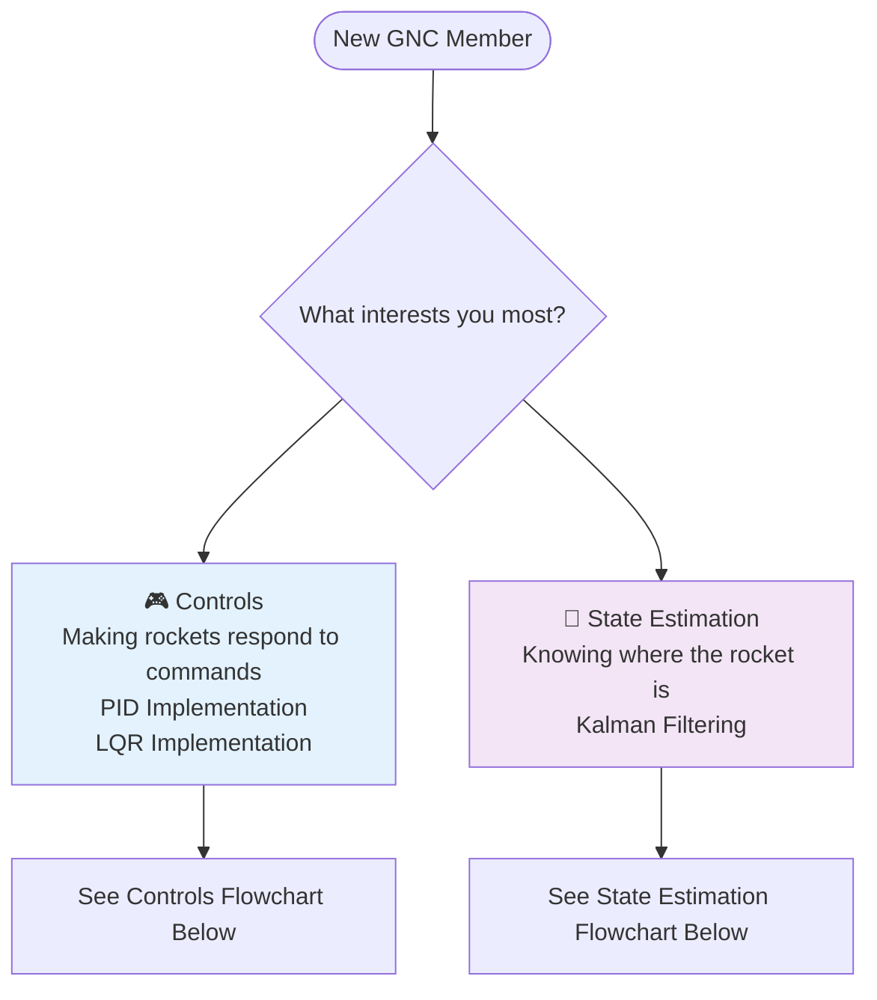
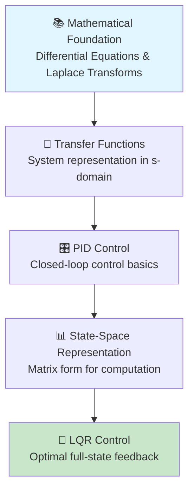
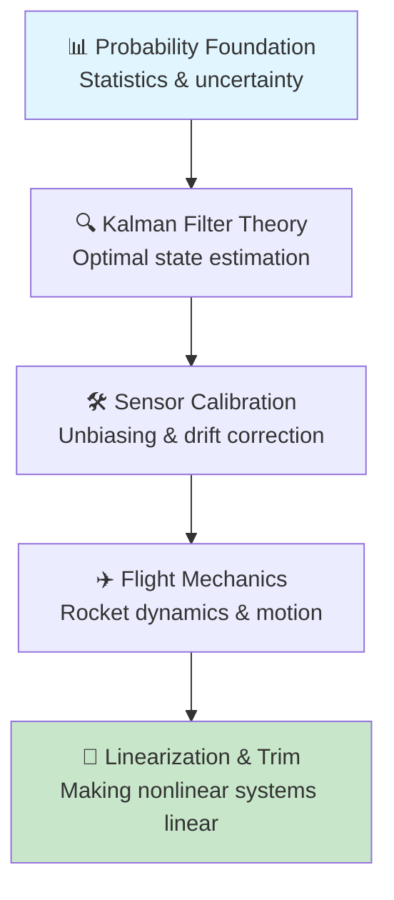

# Controls Team Learning Path

## Why This Matters

Controls is a difficult subject that requires a lot of prerequisite knowledge to meaningfully contribute to a project such as the jet vanes rocket we're building. The GNC (Guidance, Navigation, and Control) team works on complex rocket control systems that demand interdisciplinary knowledge spanning mathematics, engineering, and computer science.

Taking the time to learn these fundamentals will benefit you not only as a member of GNC, but also as a student and for your resume. At Georgia Tech, the traditional path to controls knowledge requires taking PHYS 2211, COE 2001, AE 2220/MATH 2552, AE 3530, and finally AE 3531 - meaning it takes at least two years from physics to reach control theory. This bootcamp condenses that knowledge into focused, practical learning paths.

---

## 🎯 Choose Your Learning Path

---

## 🎮 Controls Learning Path

**Goal**: Learn from the ground-up until Linear Quadratic Regulator (LQR) control

---

## 📡 State Estimation Learning Path

**Goal**: Accurately determine rocket position, velocity, orientation using noisy sensor data

---

## 🎯 Learning Strategy Recommendations

- **Take detailed notes** - Keep a technical notebook or digital documentation
- **Implement in code** - Don't just watch videos, write and test examples
- **Ask for guidance** - Engage with team leads, but work to figure out answers yourself
- **Start small projects** - Apply knowledge immediately to reinforce learning

### Success Factors
Your learning is a function of how much effort you put into it. Team members who actively engage with leads, take good notes, and implement concepts in code learn a lot faster.